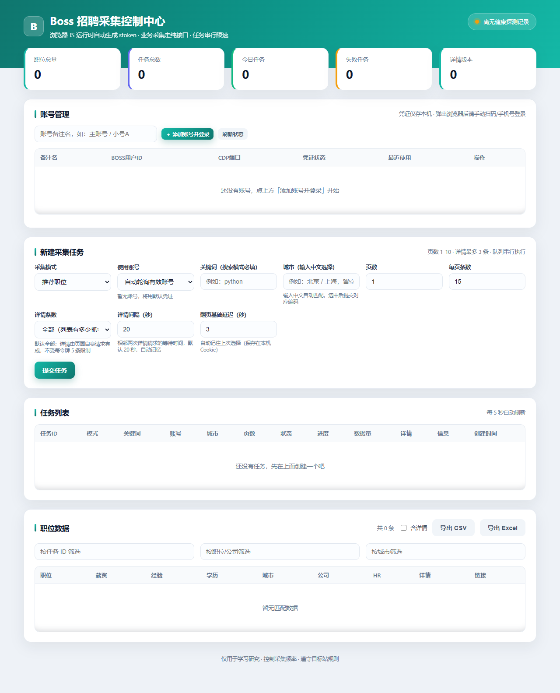

# Boss 招聘数据采集与技能图谱平台

> **项目状态：持续迭代中。** 站点结构、接口字段和风控策略可能变化，采集逻辑会持续调整；请先小批量试跑。



一个带 Web 控制台的 BOSS 直聘数据采集与分析工具：浏览器负责登录态与令牌轮换，详情请求走页面自身请求链路，任务队列串行限速；列表与详情分表存储、详情按内容哈希版本化，并支持 RedisBloom 去重、实时进度与 CSV / Excel 导出。

在采集数据之上，项目还提供**职位技能图谱**与**候选技能池**：从 `job_details.post_description` 正文抽取技能，按职位生成热力词云和学习路径；候选词可人工确认，也可由可选 LLM 辅助判断后写入 MySQL 正式词典。

## 主要功能

### 采集能力

- **两种采集模式**：推荐职位流、关键词搜索。
- **城市选择**：输入中文城市名自动匹配编码，内置 374 个城市。
- **分页参数**：页数 1-10，每页 1-15 条。
- **翻页延迟**：默认 3 秒，可在页面调整并记忆到本机 Cookie。
- **详情采集**：支持「全部 / 不抓 / 前 N 条」，相邻请求间隔可调，默认 20 秒。
- **浏览器详情引擎**：在采集浏览器中调用页面自身 axios 实例，由站点响应拦截器处理 `__zp_stoken__` 轮换。
- **详情自愈**：页面被重置导致请求上下文丢失时自动重建；遇到 35/36/37 风控码自动刷新并重试；页面不是招聘 SPA 时自动回到列表页。
- **纯接口回退**：没有可用浏览器时回退到 requests 引擎，并执行令牌刷新与风控重试。
- **RedisBloom 去重**：按跨任务稳定的 `encrypt_job_id` 判断是否已采过，按自然日分桶、TTL 1 天；布隆阳性再查 MySQL 确认，Redis 不可用时自动降级。
- **历史详情回填**：`backfill_details.py` 可为已采集职位补详情，支持断点续跑、去重和风控自动停止。

### 账号与登录态

- **多账号管理**：每个账号独立 Chrome profile 与独立 CDP 端口，登录态互不串号。
- **人工登录**：添加账号后弹出独立浏览器，手动扫码或手机号登录，工具自动抓取并保存 Cookie。
- **登录态探活**：任务提交前和执行前都会检测凭证；失效账号会被拦截并提示重新登录。
- **自动轮询账号**：任务不指定账号时，自动选择最久未使用的有效账号。
- **登录态打开职位**：职位列表的「打开」按钮使用带登录态的浏览器打开详情页，只允许 `zhipin.com` 链接。
- **风控冷却**：账号命中详情风控后记录冷却截止时间，避免继续触发安全校验。

### 数据与存储

- **列表与详情分表**：列表写入 `jobs`，详情写入 `job_details`，通过 `lid` 关联。
- **详情版本化**：对业务字段规范化后计算 SHA-256；内容变化才新增版本，未变化只刷新采集时间、观测次数等易变字段，同时保留完整 `raw_json`。
- **请求日志**：`detail_requests` 记录每次详情请求的返回码与时间，便于排查配额和风控。
- **导出**：支持按任务 ID、关键词、城市筛选，导出 CSV / Excel，可选附带详情列。

### Web 控制台

- **实时统计**：职位总量、任务总数、今日任务、失败任务、详情版本数与接口健康状态。
- **任务进度**：运行中的任务显示迷你进度条；点击任务 ID 打开进度弹窗，每 1.5 秒刷新，展示阶段、成功/失败/跳过/总数、预计剩余时间、当前职位和最近事件。
- **任务日志**：每个任务写入 `data/logs/task_<id>.log`，记录参数、阶段、子进程输出、详情信封汇总和异常堆栈。
- **职位浏览**：列表筛选与分页；详情抽屉展示职位描述、技能标签、公司介绍、福利、地址与静态地图、BOSS 头像与活跃状态、版本数和采集时间。
- **账号管理**：添加、删除、重新登录，实时展示登录态探活结果。
- **一键启动**：双击 `启动BOSS服务.bat` 启动服务并打开控制台。
- **三个独立页面**：导航固定为 `数据采集` `/`、`职位技能图谱` `/skills`、`候选技能池` `/candidates`，采集与分析互不干扰。
- **本地词云资源**：ECharts 与 wordcloud 脚本已内置到 `static/vendor/`，无需访问公网 CDN。

### 职位技能图谱

- **JD 正文抽取**：只读取 `job_details.post_description`，不使用 `jobs.skills` 标签，避免标签噪声。
- **MySQL 正式词典**：运行时词典存于 `skill_catalog` / `skill_catalog_meta`，`static/skill_catalog.json` 仅用于首次迁移播种。
- **职位技能画像**：输入职位名即可统计必备技能、加分技能、命中职位数，并用 ECharts 热力词云展示；频次越高，字号越大、颜色越深。
- **学习路径**：按词典中的 `roadmap_order` 输出建议学习顺序。
- **技能匹配**：输入已掌握技能，计算对目标职位的覆盖率，并列出已掌握与缺失技能。
- **可重建索引**：`POST /api/skills/rebuild` 会从全部详情正文重建 `job_skills`。

### 候选技能池

- **规则挖掘**：从详情正文中发现词典未收录的高频片段，写入 `skill_candidates`。
- **自动挖掘**：服务启动时会同步执行一次候选挖掘，避免页面加载到失效的候选 ID。
- **人工审核**：可逐条填写“标准名称 / 分类”后加入正式技能池，填写内容会保存到候选记录，刷新页面仍保留。
- **忽略候选**：“忽略”会把状态改为 `rejected`，不会删除历史记录。
- **可选 LLM**：配置 `BOSS_LLM_BASE_URL` / `BOSS_LLM_API_KEY` / `BOSS_LLM_MODEL` 后可对候选给出结构化建议；未配置时页面仍可人工处理。
- **筛选**：候选列表支持按状态（待处理 / 已加入 / 已忽略 / 全部）、LLM 状态和关键词筛选，默认只显示待处理。

## 快速开始

### 1. 环境要求

- Python 3.10+（当前开发使用 Python 3.13）
- MySQL 5.7+
- Chrome / Chromium（账号登录和浏览器详情引擎）
- Docker（可选，用于 MySQL 与 RedisBloom）

```powershell
python -m pip install -r requirements.txt
```

### 2. 启动 MySQL

项目默认连接 `127.0.0.1:3307` 的 `boss_recruit` 库。表结构见 `sql/init.sql`。

也可以使用 compose 中的隔离实例：

```powershell
docker compose --profile standalone up -d
```

> 注意：compose 中的 MySQL 映射到宿主机 `3308`，端口与默认配置不同；如需使用，请在 `.env` 中把 `BOSS_DB_PORT` 改为 `3308`，并填写对应的 `MYSQL_PASSWORD`。

### 3. 启动 RedisBloom（可选）

```powershell
docker compose up -d redis-bloom
```

使用包含 RedisBloom 模块的 `redis-stack-server` 镜像，映射到 `127.0.0.1:6380`。

### 4. 配置环境变量

复制 `.env.example` 为 `.env`，填写数据库和 Redis 配置。`.env` 已被 `.gitignore` 排除，不会提交。

主要配置项：

| 变量 | 默认值 | 说明 |
|---|---|---|
| `BOSS_DB_HOST` / `BOSS_DB_PORT` | `127.0.0.1` / `3307` | MySQL 地址 |
| `BOSS_DB_USER` / `BOSS_DB_PASSWORD` | `boss` / 空 | MySQL 账号 |
| `BOSS_DB_NAME` | `boss_recruit` | 数据库名 |
| `BOSS_REDIS_URL` | `redis://127.0.0.1:6380/0` | RedisBloom 地址 |
| `BOSS_BLOOM_ENABLED` | `1` | 是否启用详情去重 |
| `BOSS_BLOOM_TTL_DAYS` | `1` | 去重窗口（自然日） |
| `BOSS_BLOOM_ERROR_RATE` / `BOSS_BLOOM_CAPACITY` | `0.01` / `100000` | 布隆误判率与容量 |
| `BOSS_BLOOM_PREFIX` | `boss:detail:bf:` | 布隆 key 前缀 |
| `BOSS_MIN_TASK_INTERVAL` | `300` | 任务之间最小间隔（秒） |
| `BOSS_STOKEN_WAIT` | `60` | 刷新令牌后的等待（秒） |
| `BOSS_CDP_PORT_BASE` | `9300` | 账号 CDP 端口起始值 |
| `BOSS_CHROME_PATH` | Chrome 默认路径 | 指定 Chrome 可执行文件 |
| `BOSS_LLM_BASE_URL` | 空 | OpenAI 兼容 Chat Completions 地址；为空则不调用 LLM |
| `BOSS_LLM_API_KEY` | 空 | LLM API Key |
| `BOSS_LLM_MODEL` | `gpt-4o-mini` | 候选审核使用的模型名 |

### 5. 启动服务

双击 `启动BOSS服务.bat`，浏览器会自动打开：

```text
http://127.0.0.1:8899
```

也可以手动启动：

```powershell
python -m uvicorn app:app --host 127.0.0.1 --port 8899
```

### 6. 使用流程

1. 在「账号管理」添加账号，在弹出的独立浏览器里手动登录；
2. 在「新建采集任务」选择模式、账号、关键词、城市、页数与详情设置；
3. 提交后任务进入串行队列，点击任务 ID 查看实时进度与日志；
4. 在「职位数据」筛选、查看详情并导出 CSV / Excel；
5. 打开「职位技能图谱」，输入职位名查看技能热力词云、技能清单与学习路径；
6. 展开技能匹配区，输入已掌握技能计算覆盖率；
7. 打开「候选技能池」，按状态/LLM/关键词筛选候选，人工确认或借助可选 LLM 建议加入正式词典。

## 项目结构

```text
.
├── app.py                      # FastAPI 服务、任务队列、账号与查询接口
├── job_api.py                  # 列表与详情采集，浏览器 / requests 双引擎
├── browser_detail.py           # 页面 axios 详情引擎、上下文重建、风控重试
├── detail_hash.py              # 详情字段规范化、SHA-256、入库映射
├── detail_dedupe.py            # RedisBloom 日桶去重
├── progress_store.py           # 任务进度与事件旁路存储
├── backfill_details.py         # 历史详情回填
├── db.py                       # MySQL 访问层、幂等建表与迁移
├── account_manager.py          # 多账号浏览器、登录态抓取与探活
├── stoken_browser.py           # CDP 刷新 stoken 与 Cookie
├── config.py                   # 项目配置与环境变量加载
├── skill_extractor.py          # JD 正文技能抽取与候选发现（MySQL 词典）
├── skill_graph.py              # 技能图谱、推荐、匹配、候选审核
├── llm_reviewer.py             # 可选 OpenAI 兼容 LLM 候选审核
├── static/index.html           # 数据采集控制台
├── static/skills.html          # 职位技能图谱页
├── static/candidates.html      # 候选技能池页
├── static/vendor/              # 本地 ECharts / wordcloud 静态资源
├── sql/init.sql                # 数据库初始化脚本
├── tests/                      # 单元测试、集成测试与 Web 全功能回归脚本
├── docs/images/web-ui.png      # README 界面截图
└── docker-compose.yml          # RedisBloom 与隔离 MySQL
```

运行期文件均位于 `.gitignore` 排除的 `data/` 下：

- `data/accounts/<id>.json`：账号凭证；
- `data/profiles/<id>/`：账号独立浏览器 profile；
- `data/progress/task_<id>.json`：任务进度（7 天自动清理）；
- `data/logs/task_<id>.log`：任务日志；
- `data/task_<id>_*.json/csv`：列表与详情产物；
- `data/exports/`：导出的 CSV / Excel 文件。

## 主要接口

| 方法 | 路径 | 说明 |
|---|---|---|
| GET | `/` | 数据采集控制台 |
| GET | `/skills` | 职位技能图谱页 |
| GET | `/candidates` | 候选技能池页 |
| GET | `/api/stats` | 统计信息 |
| GET | `/api/cities` | 城市码表 |
| GET | `/api/accounts` | 账号列表（含探活） |
| POST | `/api/accounts/login` | 添加账号并打开登录浏览器 |
| GET | `/api/accounts/{id}/login-status` | 查询登录状态 |
| POST | `/api/accounts/{id}/relogin` | 重新登录 |
| DELETE | `/api/accounts/{id}` | 删除账号 |
| POST | `/api/open-link` | 在登录态浏览器打开职位链接 |
| GET / POST | `/api/tasks` | 任务列表 / 新建任务 |
| GET | `/api/tasks/{id}` | 任务详情 |
| GET | `/api/tasks/{id}/progress` | 任务实时进度 |
| GET | `/api/tasks/{id}/log` | 任务日志 |
| GET | `/api/jobs` | 职位查询（带详情标记） |
| GET | `/api/details/{lid}` | 职位最新详情与版本列表 |
| GET | `/api/export` | 导出 CSV / Excel（`with_details=1` 含详情） |
| GET | `/api/skills/catalog` | MySQL 正式技能词典 |
| POST | `/api/skills/recommend` | 输入职位名生成技能画像 |
| GET | `/api/skills/graph` | 技能共现图与职位证据 |
| POST | `/api/skills/match` | 已掌握技能与职位要求匹配 |
| POST | `/api/skills/rebuild` | 从详情正文重建 `job_skills` |
| GET | `/api/skills/candidates` | 候选技能列表与 LLM 状态 |
| POST | `/api/skills/candidates/mine` | 重新挖掘候选词 |
| POST | `/api/skills/candidates/review` | 可选 LLM 判断候选 |
| POST | `/api/skills/candidates/apply` | 批量应用 LLM 建议 |
| POST | `/api/skills/candidates/{id}/approve` | 人工确认单个候选进正式池 |
| POST | `/api/skills/candidates/{id}/reject` | 忽略候选（状态改为 `rejected`） |

## 测试

运行 pytest 回归（排除依赖本机浏览器 CDP 的用例）：

```powershell
python -m pytest -q --ignore=test_stoken_local.py
```

测试覆盖详情哈希与版本决策、RedisBloom 去重、详情入库、进度存储、技能抽取与候选审核。涉及 MySQL / Redis 的测试需要对应实例可用。

### Web 全功能回归

项目使用工作区级 Agent Skill `webapp-testing`（安装路径 `../.codebuddy/skills/webapp-testing`）执行真实浏览器点击流验证。**新增功能或大改动后，必须先用该 skill 做页面点击流与数据库验证，再视为完成。**

首次运行需安装 Playwright 浏览器：

```powershell
python -m pip install -r requirements.txt
python -m playwright install chromium
```

启动服务后运行全功能回归：

```powershell
python tests/web_full_regression.py
```

该脚本覆盖：

- 三个页面的点击流与 console/pageerror 检查；
- 统计、城市、职位、详情、任务、日志、导出等 API；
- 技能词典、图谱、推荐、匹配、候选池 API；
- 候选筛选、人工加入词典、忽略、LLM 未配置路径；
- 页面操作与 MySQL 落库一致性。

报告与截图输出到 `D:\Scrapy-project\artifacts\web_full_regression\`。脚本会临时写入两条候选用于验证，结束后自动清理并恢复词典版本。

> `POST /api/tasks` 真实采集、账号登录/重新登录/删除具有外部副作用，回归脚本默认跳过，仅在明确需要时手动执行。

## 说明与技术细节

- **去重语义**：`BOSS_BLOOM_TTL_DAYS=1` 表示按自然日去重，跨天视为未采集；设为 2 可检查今天和昨天两个桶。
- **详情引擎**：依赖页面 SPA 的 webpack 模块。站点大版本更新后若模块结构变化，会自动回退到 requests 引擎，此时重新受每令牌约 5 条限制，但会定期刷新令牌。
- **登录态隔离**：不同账号使用不同 Chrome profile 和 CDP 端口，避免 Cookie 串号。
- **技能数据源**：正式词典来自 MySQL `skill_catalog`；`static/skill_catalog.json` 只在空库时播种一次，运行时读取 JSON 已弃用。技能统计只使用 `job_details.post_description`，不使用 `jobs.skills`。
- **启动行为**：服务启动时会执行 `db.init_db()`、清理过期进度文件，并同步挖掘一次候选技能；这一步会重建 pending 候选并改变其 ID，因此页面打开后不要复用旧 ID。
- **候选筛选范围**：筛选在前端对已加载的最多 500 条候选生效；当前数据量低于上限。若后续超过 500，需要把筛选下推到 API 并加分页。
- **安全边界**：凭证仅存本机；`.env`、账号 Cookie、浏览器 profile、日志、导出文件和截图临时目录均不提交到仓库。
- **合规**：仅用于学习研究，内置任务串行限速与请求间隔。请遵守目标站点服务条款，控制访问频率，不要用于骚扰、爬取隐私数据或其他违规用途。
